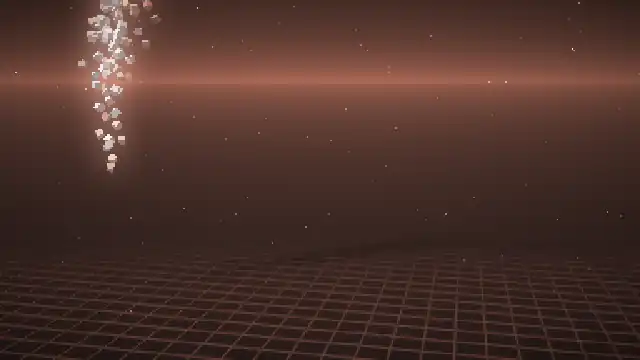

# ELD Voxels: an Omarchy screensaver

The ELD logo as roughly 4,800 voxels, rendered in 3D inside the terminal like
Omarchy's own screensaver. Each terminal cell shows two truecolor pixels, drawn
with the `▀` half-block character.

**It follows your Omarchy theme.** Every color comes from the active theme's
`colors.toml`: logo, sky, floor and glow. If you switch themes while it is
running, it fades to the new colors within a couple of seconds.



Each cycle the logo drops out of the sky and bounces into place, and a sweep of
light passes across it. Then it plays four random acts:

| act       | what happens                                                         |
|-----------|----------------------------------------------------------------------|
| `wave`    | a ripple rolls through the logo                                      |
| `explode` | voxels burst out, tumble, bounce on the floor, then fly back home     |
| `globe`   | the logo wraps itself around a spinning planet                       |
| `torus`   | the logo wraps around a tumbling donut                               |
| `vortex`  | the voxels are pulled up into a swaying tornado                      |
| `galaxy`  | a three-armed spiral galaxy with a glowing core                      |
| `helix`   | a double helix with rungs                                            |

At the end of the cycle the voxels lift off, and the next cycle starts with a
new palette:

- **Brand**: light faces tinted with the theme accent, and an accent-colored extrusion
- **Spectrum**: the theme's whole rainbow
- **Duo**: accent to magenta
- **Aurora**: northern-lights gradient

Each palette is built from the active theme's colors. The theme is
re-checked about once a second. To preview another theme without switching
to it, point `ELD_VOXELS_THEME` at that theme's `colors.toml`.

The scene also has a synthwave grid floor with reflections and soft shadows,
twinkling stars, shooting stars, floating dust, bloom and a vignette.

## Install

Needs Rust (`cargo`), which Omarchy already has.

```bash
./install.sh
```

This script:

1. builds the renderer and installs `eld-voxels`, `eld-screensaver` and
   `eld-screensaver-launch` into `~/.local/bin`, plus a foot config into
   `~/.local/share/eld-voxels/`;
2. hooks Omarchy's idle screensaver. The idle service starts the screensaver
   with `bash -lc omarchy-launch-screensaver`, so a function of that name in
   `~/.bash_profile` (between `eld-voxels` marker comments) sends it to
   `eld-screensaver-launch`. If the launcher is missing, the function falls
   back to the stock command;
3. points **Menu → System → Screensaver** at it, using
   `~/.config/omarchy/extensions/omarchy-menu.jsonc`.

To install only the binaries, use `./install.sh --no-hook`. To undo everything,
run `./uninstall.sh`.

The idle timeout, the screensaver toggle and the lock timer keep working as
before. They live in `~/.config/omarchy/shell.json` and the Omarchy menu.

## Use

```bash
eld-voxels                     # preview in the current terminal
eld-voxels --act galaxy        # start with a particular act
eld-screensaver-launch force   # full screen on every monitor, like idle does
```

In preview mode, `n` skips to the next act and `p` switches palette. Any other
key quits. As a screensaver it quits on any key, on mouse movement, or when
focus moves away. Then it closes the screensaver windows on all monitors.

### Tuning

`eld-screensaver-launch` reads these environment variables. The idle service
launches it from a login shell, so export them in `~/.bash_profile`:

| variable               | default | effect                                                       |
|------------------------|---------|--------------------------------------------------------------|
| `ELD_VOXELS_FONT_SIZE` | `6`     | terminal font size. Smaller means sharper but choppier       |
| `ELD_VOXELS_FPS`       | `30`    | target frame rate                                            |

The real limit is the terminal. foot repaints the grid on the CPU, and the
number of cells decides how often it can show a new frame. These are
foot's own render timings on a 4K screen:

| font size | canvas    | frames foot actually shows |
|-----------|-----------|----------------------------|
| 4         | 640×288   | ~10 fps                    |
| 5         | 480×240   | ~16 fps                    |
| 6         | 384×196   | ~28 fps (default)          |

## Using a different logo

The voxel layout comes from `assets/eld.mask`, which was generated from
`assets/eld-logo.png`. Any transparent PNG works:

```bash
python3 tools/png2mask.py my-logo.png 72 > assets/eld.mask   # 72 voxels wide
./install.sh
```

You can also pass `--mask file` at runtime. A cell is filled when at least 55%
of its area is covered, which keeps thin gaps between letters open. Change the
threshold with a third argument. `--depth N` sets the extrusion depth.

## How it works

A dependency-free Rust CPU renderer (`src/`):

- `scene.rs`: the voxel logo and the choreography. Each act is a list of
  phases: *morph* from a snapshot toward a target shape (which may be moving),
  *hold* a shape, or run a small *explode* physics simulation. Every act starts
  and ends with the logo assembled, so acts can play in any order.
- `render.rs`: the floor pass (one ray per row, since the camera never rolls),
  a soft shadow map projected along the light, mirrored voxels for
  reflections, and a z-buffered cube rasterizer with perspective-correct face
  outlines. After that come dust, meteors, a 4× downsampled bloom and
  tonemapping. Projection runs on one thread. Rasterization and the per-pixel
  passes run in screen bands across up to 4 threads.
- `term.rs`: turns pairs of pixels into `▀` cells and only re-sends cells that
  changed. Each frame is wrapped in synchronized-update escapes, and a writer
  thread streams it while the next frame renders.

Developer options:

```bash
eld-voxels --snapshot out.png --at 14 --act globe --size 640x288 --aspect 1.25
eld-voxels --snapshot f.png --frames 60 --fps 12      # frame sequence
eld-voxels --bench 300 --size 640x288 > /dev/null     # per-stage timings
```
